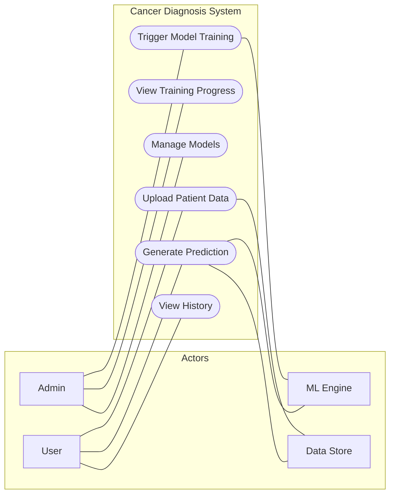
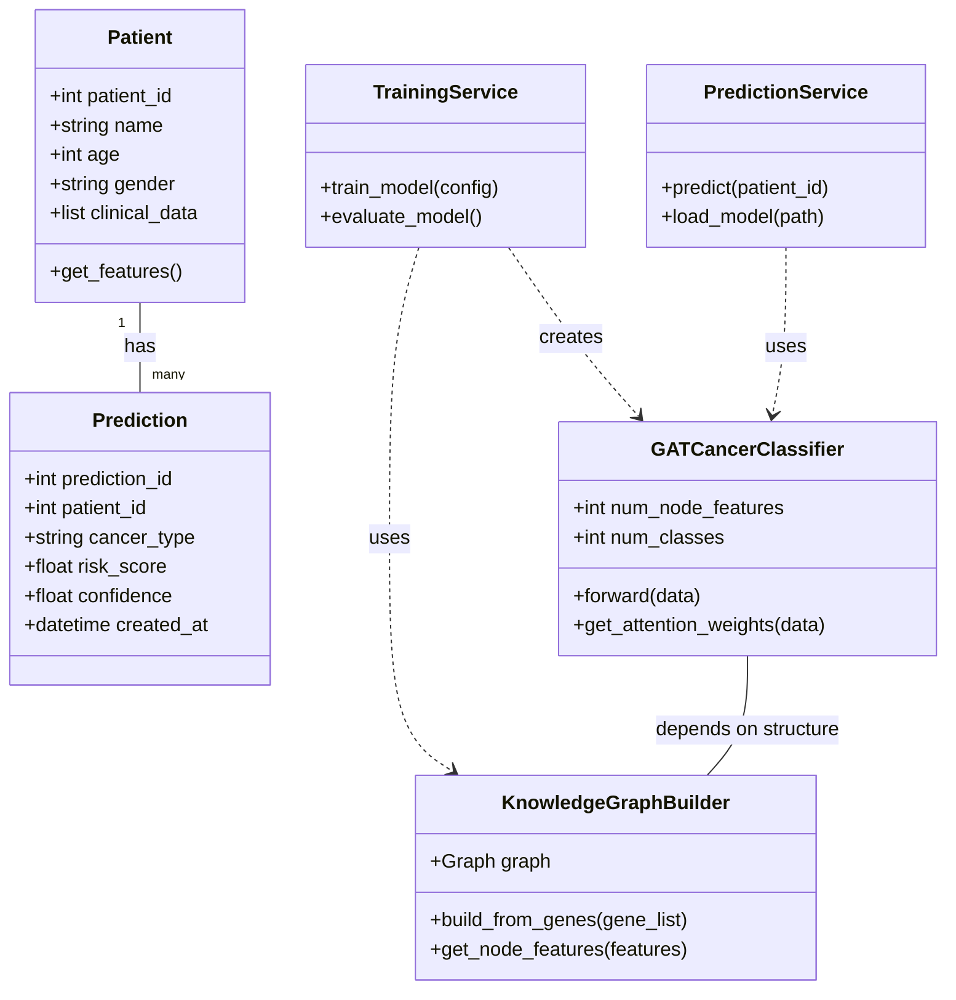
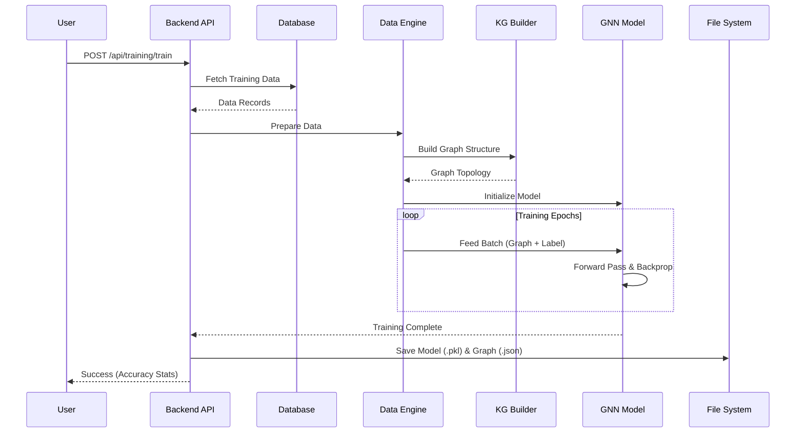
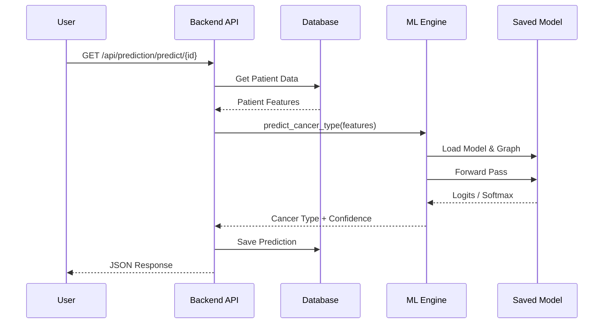
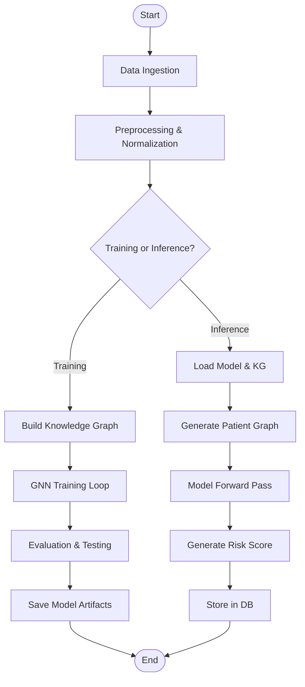
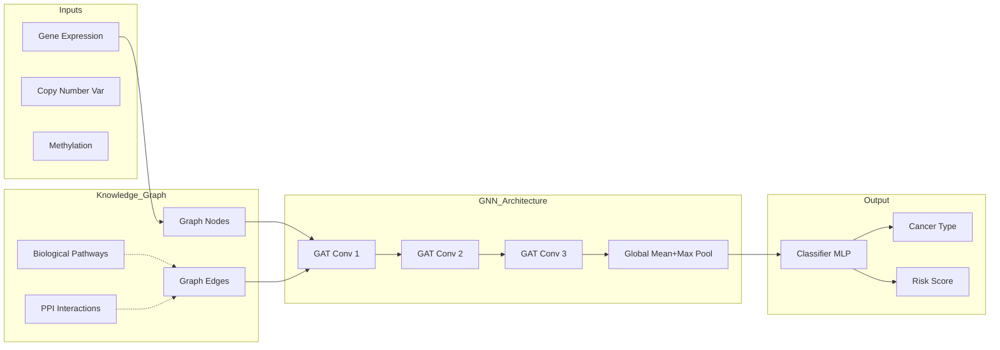
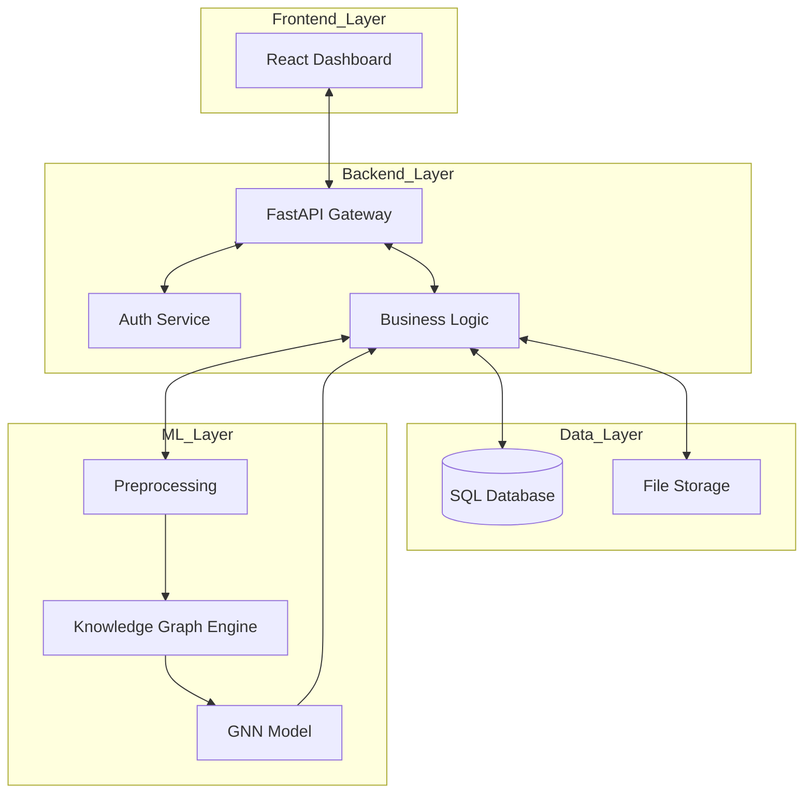

# System Analysis & UML Documentation

## 1. Code Repository Analysis

### Folder Structure Overview
*   **backend/**: FastAPI application serving as the core system logic.
    *   `api/`: REST endpoints for Auth, Patients, Training, Prediction.
    *   `database/`: SQLAlchemy models and connection logic (MySQL/MariaDB).
    *   `models/`: Pydantic schemas for request/response validation.
*   **frontend/**: React web application (likely Vite based on structure).
    *   Uses TailwindCSS for styling.
    *   Consumes backend APIs.
*   **ml_engine/**: Core Machine Learning logic.
    *   `gnn_model.py`: PyTorch Geometric implementation of GAT (Graph Attention Network).
    *   `knowledge_graph.py`: NetworkX-based knowledge graph builder integration biological pathways (PI3K, p53, etc.).
    *   `train_model.py`: Training pipeline with custom `CancerDataset` and PyTorch training loop.
*   **data/**: Dataset storage (CSV files).

### Core Components
*   **API Layer**: FastAPI routers organize endpoints by functionality.
*   **ML Integration**: Synchronous/Asynchronous calls from Backend to `ml_engine` functions.
*   **Database**: Relational database storing User, Patient, and Prediction data.

---

## 2. Data & Training Analysis

### Data Pipeline
1.  **Source**: Multi-omics data (mRNA, miRNA, Methylation) + Clinical data (Cancer Type).
2.  **Ingestion**: `data_loader.py` reads CSV or Database exports.
3.  **Preprocessing**:
    *   StandardScaler normalization.
    *   Mapping genes to Knowledge Graph nodes.
    *   Construction of Graph Data objects (Nodes = Genes/Pathways, Edges = Interactions).
4.  **Graph Construction**:
    *   Genes are nodes.
    *   Edges defined by biological pathways (KEGG/Reactome-like relationships defined in `knowledge_graph.py`).
    *   Node features are the omics values.

### Training Workflow
1.  **Trigger**: API call to `/api/training/train` or script `train_model.py`.
2.  **KG Building**: `KnowledgeGraphBuilder` creates the structure.
3.  **Dataset Creation**: Topologies + Features -> `CancerDataset`.
4.  **Training**:
    *   PyTorch loop.
    *   AdamW Optimizer with Cosine Annealing.
    *   Cross Entropy Loss.
5.  **Output**: Model artifact (`.pkl`) and Knowledge Graph JSON saved to `models/`.

---

## 3. Model Analysis

*   **Type**: Graph Neural Network (GNN).
*   **Architecture**: Graph Attention Network (GAT).
    *   **Input**: Node features (Gene expression levels).
    *   **Layers**: 3-4 GATConv layers with Multi-head attention.
    *   **Pooling**: Global Mean + Global Max pooling.
    *   **Classifier**: 2-layer MLP (Linear -> ReLU -> Dropout -> Linear).
*   **Logic**: The model learns to classify cancer types not just by raw values, but by how gene expression propagates through known biological pathways.

---

## 4. System & Workflow Analysis

### User Flow
1.  **Login**: User authenticates via React Frontend -> FastAPI Auth.
2.  **Data Upload**: User uploads patient data.
3.  **Training**: User triggers model training. Backend runs `train_gnn_model`.
4.  **Prediction**: User requests prediction for a patient.
    *   Backend fetches patient data.
    *   Loads latest Model + KG.
    *   Runs inference (`predict_cancer_type`).
    *   Stores result in DB.
    *   Returns risk score and confidence.

---

## 5. UML Diagrams

### 1️⃣ Use Case Diagram

### 2️⃣ Class Diagram

### 3️⃣ Sequence Diagram (Training)

### 4️⃣ Sequence Diagram (Prediction)

### 5️⃣ Activity Diagram (End-to-End)

### 6️⃣ Model Flow Diagram

### 7️⃣ Proposed Project Workflow (System Architecture)

